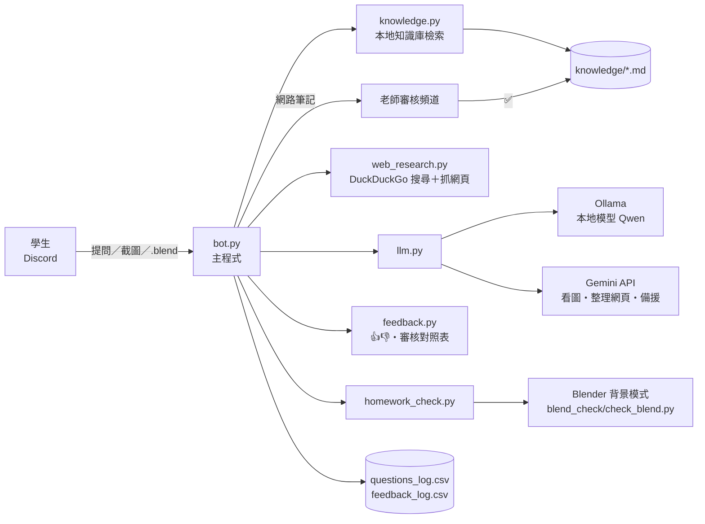
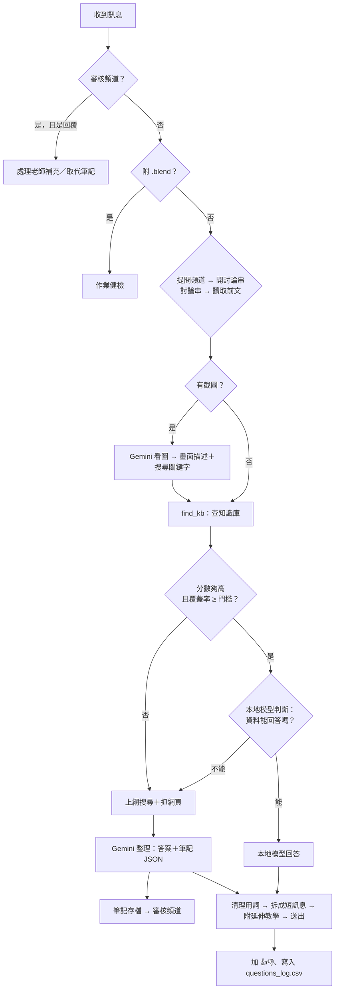

# Blender 課程 AI 教學助理｜技術文件

> 對應版本：v13（GitHub `YAOAOAO7121/Blender-DC-AI-Bot`，2026/11）
> 這份文件說明機器人**怎麼做的、為什麼這樣做**。安裝請看 `安裝步驟.md`。

---

## 1. 一句話說明

學生在 Discord 提問 → 機器人**先查本地的課程知識庫**，查得到就用**本地模型（Ollama）**回答、不花 API；查不到就**上網搜尋、抓網頁**，交給 **Gemini** 整理成答案回給學生，同時把內容**整理成筆記存回知識庫**（可設定要老師審核），下一次同樣的問題就能在本地回答。回答語氣模仿小樽老師。

設計目標（來自老師的需求）：

1. **以本地執行為主**，只在需要新增知識時才呼叫 API
2. 知識庫會**自己長大**：網路查到的東西沉澱成課程筆記
3. 老師保有**最後把關權**：新知識要審核、學生可以回饋答得好不好
4. 語氣像小樽，但**不冒充老師本人**（不自稱「小樽」或「老師」）

---

## 2. 系統架構



| 元件 | 跑在哪 | 用途 |
|---|---|---|
| `discord.py` | 本機 | 收訊息、開討論串、加反應 |
| Ollama + Qwen | 本機 GPU | 主要回答者；也負責「資料夠不夠」判斷、產生英文搜尋關鍵字 |
| Gemini | Google 雲端 | 看截圖、整理網頁並寫筆記、本地失敗時的備援 |
| DuckDuckGo（`ddgs`） | 網路 | 搜尋，不需金鑰 |
| Blender（背景模式） | 本機 | 作業健檢 |

---

## 3. 檔案結構

| 檔案／資料夾 | 內容 |
|---|---|
| `bot.py` | 主程式：Discord 事件、回答流程、審核、作業健檢、截圖、紀錄（約 1000 行） |
| `knowledge.py` | 知識庫切段、檢索（BM25）、覆蓋率、章節分類 |
| `llm.py` | Ollama 與 Gemini 的呼叫、重試、思考過程過濾、簡轉繁 |
| `web_research.py` | 網路搜尋、抓網頁正文、延伸教學連結 |
| `homework_check.py` | 作業健檢的排隊、呼叫 Blender、報告格式化 |
| `blend_check/check_blend.py` | 在 Blender 裡面執行的檢查腳本（用 `bpy`） |
| `admin.py` | 老師自訂介面：`/語氣`、`/用詞`、`/試答` 斜線指令；用詞替換與語氣備份 |
| `feedback.py` | `JsonIndex`（訊息 ID → 資料的持久化對照表）、回饋紀錄 |
| `knowledge/` | 課程知識庫，一個主題一個 .md；`網路整理/` 是審核通過的網路筆記 |
| `knowledge_待審核/`、`knowledge_已退回/` | 審核流程中的筆記 |
| `persona/` | 語氣設定：`小樽_完整.md`（給 Gemini）、`小樽_精簡.md`（給本地小模型） |
| `install.bat` / `install.ps1` | Windows 一鍵安裝：裝 Python／Git、建 `.venv`、依顯卡挑模型並驗證 100% GPU、寫 `.env`、用 Discord／Gemini API 檢查 Token、Intent、頻道與金鑰、建立啟動捷徑 |
| `assets/` | 桌面按鈕圖示：`start.ico`（使用小樽影分身之術）、`stop.ico`（解除小樽影分身） |
| `tests/` | 不開 Discord 就能測的工具 |
| `backup/` | 舊版程式備份 |

---

## 4. 一則提問的完整流程（`on_message`）



### 4.1 判斷要不要回應
- 只處理兩個地方的訊息：**提問頻道**（`ASK_CHANNEL_ID`）的新訊息，以及**機器人開的討論串**裡的追問。其他頻道一律忽略。
- 新問題 → `message.create_thread()` 開討論串，所有回答都在討論串裡，提問頻道保持乾淨。

### 4.2 追問的上下文（`build_history`）
- 讀討論串最近 30 則，整理成 `user / assistant` 交錯的對話；開討論串的第一則訊息（學生原始問題）另外抓回來補在最前面。
- 濾掉機器人的系統訊息（「🔎 我上網找一下」、作業健檢的「收到」）和附註小字（`-#` 開頭）。
- 有追問時會在 system prompt 加上 `FOLLOWUP_RULE`：「只回答最新的問題」，避免模型把第一題重講一遍。

### 4.3 找資料（`find_kb`）— 追問的特殊處理
追問有兩種，處理方式不同：

| 類型 | 例子 | 怎麼查 |
|---|---|---|
| 完整的新問題 | 「那要怎麼綁骨架」 | **只用最新那句**查，避免一直拿到第一題的資料 |
| 看不懂的短追問（`is_vague`：少於 12 字，或以「那、這、它、還有、如果…」開頭） | 「那如果找不到圖片呢」 | 「最新那句」和「第一題＋追問」各查一次，**兩邊都有的段落**優先 |

### 4.4 資料是不是真的在講這題（兩道關卡）
1. **關鍵字覆蓋率**（`kb.coverage`）：問題中的關鍵字，依稀有度（IDF）加權後有多少比例出現在找到的段落裡。低於 `KB_MIN_COVERAGE`（預設 0.15）就當作沒資料。
   → 原因：BM25 分數會隨問題變長而變高，只看分數會把「沾到邊」的資料當成答案。
2. **本地模型判斷**（`LOCAL_JUDGE=1`，`llm.local_judge`）：把資料和問題丟給本地模型，只准回答「能」或「不能」。回答「不能」就改上網查。
   → 原因：資料可能只「提到」相關名詞，但沒講到學生真正問的東西。

通過後再用 `focus_hits` 只留**分數 ≥ 最高分 × `LOCAL_KEEP_RATIO`** 的段落、最多 2 段，避免把不相關的段落塞給模型（小模型很容易被帶偏）。

### 4.5 產生回答
**有資料（`answer_from_kb`）**
- 本地模型：system prompt 用精簡版語氣；**資料、問題和規則都放在最後一則 user 訊息**（小模型對最後一則的指令遵守度最高）。規則包括：快捷鍵照資料寫、資料沒提到的不准補、2–4 行、編號最多 5 步、不要自稱小樽。
- 溫度 0.1、最多 700 token、只帶最近 6 則對話。
- 本地失敗（沒開、逾時 180 秒、輸出思考過程）→ 改用 Gemini＋完整版語氣＋資料。

**沒資料（`answer_from_web`）**
1. 先送「🔎 我上網找一下 等我等我~」讓學生知道在處理
2. 本地模型把問題轉成 **5–8 個英文關鍵字**（Blender 的英文資料多很多）；失敗就從問題裡挑英文術語
3. `web_research.research()` 搜尋並抓最多 4 篇網頁正文
4. Gemini 一次輸出 JSON：`found`、`answer`、`sources`、`note_title`、`note`
5. `found=true` 就把 `note` 存成筆記（見第 6 節），回答附上實際用到的參考連結

**都失敗時的備援鏈**

| 情況 | 改用 |
|---|---|
| 本地模型失敗 | Gemini＋課程資料 |
| Gemini 整理網頁失敗 | 本地模型讀前兩篇網頁回答（不存筆記，附註提醒） |
| 網路查無資料 | Gemini 一般知識 → 再失敗用本地模型，附註「建議再確認或問老師」 |
| Gemini 503／429 忙線 | 間隔 2、6、18 秒重試 `GEMINI_RETRIES` 次；有設 `GEMINI_FALLBACK_MODEL` 就最後換模型試一次 |
| 全部失敗 | 送出「哎呀 我的腦袋暫時當機了XD…」 |

### 4.6 送出前的整理
- `clean_answer`：套用 `persona/用詞替換.txt`（刪掉「妥妥的」「莫慌」、「問老師」→「問小樽」…）— 模型就算被要求不要講還是偶爾會講，所以送出前直接處理。老師可以用 `/用詞` 指令自己增減。
- `tidy_local`：小模型常把答案擠成一大段 → 在句號處斷行；兩種結尾句重複時只留一句。
- `split_for_chat`：**2–5 行、220 字以內、沒有條列**的短答案，拆成幾則訊息連發，中間模擬打字停頓（0.5–2 秒），像小樽在 Discord 的聊天習慣。長的教學型回答維持一則。
- 超過 1900 字自動在換行處切成多則（Discord 上限 2000 字）。
- 附註用 `-#` 小字：參考了哪段資料、用哪個模型、分到哪一章（`SHOW_SOURCES=1`，測試期用）。
- 網址用 `<網址>` 包起來，避免 Discord 展開一堆預覽卡片。

---

## 5. 本地知識庫（`knowledge.py`）

### 5.1 切段
- 讀 `knowledge/` 底下所有 `.md`、`.txt`（含子資料夾），**檔名 `_` 開頭的不讀**（放說明或草稿）。
- 每個 `## 小標題` 切成一段；一段超過 1200 字再依空行切開。
- `<!-- -->` 註解裡的內容不參與檢索，但會取出其中的網址（網路筆記的來源），回答時附給學生。
- 每次查詢前比對檔案的修改時間，**有改動就自動重新載入**，不用重開機器人。

### 5.2 檢索：BM25 + 中文 bigram
沒有用向量資料庫或 embedding 模型，原因：資料量小（30 個檔、約 300 段）、不想多一個要跑在 GPU 上的模型、結果可以直接解釋和除錯。

- **分詞**：中文切成相鄰兩字（bigram，「布林運算」→ 布林／林運／運算），英文、數字、快捷鍵（`ctrl+a`）切成單字。
- **停用詞**：「怎麼」「什麼」「老師」「請問」等問句常見詞不算分。
- **正規化**：「第七週」「第 7 周」「禮拜七」統一成 `week7`，學生問課程進度也查得到。
- **計分**：標準 BM25（k1=1.5、b=0.75），**關鍵字出現在小標題額外加 1.5 倍 IDF**——所以知識庫的小標題要寫成學生會問的說法，並附英文名稱（例：`## 物件縮放（S）`）。
- 門檻 `KB_MIN_SCORE`（預設 4.0）以下的段落不採用。

### 5.3 章節分類（`classify`）
用較低門檻（0.5）搜尋前 8 段，**同一個檔案的分數加總**，取最高的檔名當分類（例如 `06_修改器`）。`98_`、`99_` 常見問題和網路整理的筆記不算章節。分類會寫進 `questions_log.csv`，老師可以用來看哪一章最多人問；啟動時也會幫舊紀錄補分類。

### 5.4 單獨測試
```
python knowledge.py 布林運算怎麼用
```
會列出每段的分數、是否超過門檻、覆蓋率、最後分類。

---

## 6. 網路筆記與老師審核

### 6.1 筆記存檔（`save_web_note`）
檔名 `日期_標題.md`，開頭是 `<!-- -->` 註解區，記錄：來源（AI 自動整理）、整理時間、學生原始提問、參考網址。筆記內文要求 Gemini 用**中性教學語氣**（不帶小樽的語氣詞）、`##` 小標題寫成學生的問法並附英文。

### 6.2 存到哪裡

| 設定 | 筆記去向 |
|---|---|
| 有填 `REVIEW_CHANNEL_ID` | `knowledge_待審核/` → 貼到審核頻道（`AUTO_SAVE_WEB` 被忽略） |
| 沒填、`AUTO_SAVE_WEB=1` | 直接進 `knowledge/網路整理/`，下一題就查得到 |
| 沒填、`AUTO_SAVE_WEB=0` | 只存 `knowledge_待審核/`，人工搬移 |

### 6.3 審核頻道操作
- 貼文內容：檔名、學生問題、討論串連結、參考網頁、內文預覽（1100 字），**附上 .md 檔**，並加上 ✅ ❌。
- ✅ → 檔案搬進 `knowledge/網路整理/`；❌ → 搬進 `knowledge_已退回/`。原訊息會更新顯示審核結果與審核人。
- **回覆**那則訊息：打字 → 加到筆記最後的 `## 老師補充`；上傳 .md → 整份取代（自動保留原本的來源註解）。
- `REVIEWER_IDS` 限制誰能審；空白表示看得到頻道的人都可以。
- 訊息 ID ↔ 檔案路徑存在 `review_index.json`，機器人重開後按 ✅ 還是有效；啟動時會把待審核資料夾裡**還沒貼過**的筆記補貼。

---

## 7. 語氣（persona）

- **兩份設定**：`小樽_完整.md`（約 2.6KB，給 Gemini）、`小樽_精簡.md`（約 0.6KB，給本地模型）。小模型記不住長設定，只放最重要的幾條。
- 每次回答都重新讀檔，**改了下一題就生效**；檔案第一行 `# 說明` 不會送給模型。
- 語氣是從老師的課程公告、教學文、長文、Discord 聊天紀錄整理出來的（原始語料與分析在 claude.ai Project「小樽blender教學分身」的 `persona/小樽語氣設定.md`）。
- 幾個刻意的決定：
  - **不自稱小樽或老師**，只模仿語氣（避免學生誤以為是老師本人回覆）
  - 第一句直接講答案，不寫開場白和安撫的話
  - 句尾的「唷」「XD」偶爾用，不要每句都加
  - 不模仿老師打字快不改錯字的習慣
- `PERSONA=0` 可以切回一般助教口吻（`PLAIN_PROMPT`）。
- 學生都叫老師「小樽」，所以請學生去問老師時說「問小樽」（語氣檔裡有寫，用詞替換也會把漏網的「問老師」換掉）；機器人自己仍然不自稱小樽。

---

## 7.1 老師自訂介面（`admin.py`）

用 Discord 斜線指令讓老師自己調整，不用碰檔案：

- **權限**：`REVIEWER_IDS` 裡的人或有「管理伺服器」權限的人。指令設了 `default_permissions(manage_guild)`，學生的指令清單裡看不到；每個指令執行時再檢查一次。所有回覆都是 ephemeral（只有下指令的人看得到）。
- **同步**：`on_ready` 和 `on_guild_join` 時用 `tree.sync(guild=…)` 同步到每個伺服器（伺服器指令立即生效，全域指令要等約一小時）。邀請機器人時需要 `applications.commands` scope。
- **語氣**：`/語氣 修改` 用 Modal 編輯（上限 4000 字，超過改用上傳）。每次寫入前把舊檔複製到 `persona/歷史/小樽_精簡_YYYYMMDD_HHMMSS.md`；`/語氣 還原` 用 autocomplete 列出備份，還原時現在的版本也會先備份，所以還原錯了可以再還原回來。
- **用詞替換**：`persona/用詞替換.txt`，每行 `原本 => 改成`，右邊空白代表刪除。`clean_answer` 每次送出前都重新讀檔、長的規則先套用（「莫慌莫慌」比「莫慌」先換）。取代了原本寫死在程式裡的 `BANNED_PHRASES`。檔案不存在時自動建立預設規則（刪掉「妥妥的」「莫慌」、「問老師／找老師」→「問小樽／找小樽」）。
- **試答**：`try_answer()` 走一樣的知識庫查詢、本地模型判斷與回答、用詞替換，但不上網查、不存筆記、不記錄，並顯示是否會被拆成短訊息。
- `persona/歷史/`、`persona/用詞替換.txt` 列入 `.gitignore`，是每台電腦自己的設定。

## 8. 截圖判讀

- 學生附圖片（最多 3 張、每張 8MB 以內）→ Gemini 看圖，輸出 JSON：`is_blender`、`description`（編輯器、模式、選取、面板設定、錯誤訊息、版本）、`issue`（最可能的原因）、`search`（給知識庫用的中英關鍵字）。
- 看圖結果**取代學生原本那則訊息的文字**送進後面的流程，並用 `search` 欄位查知識庫——所以截圖題也能用本地知識庫和本地模型回答。
- 描述存在 `image_notes.json`（最多 500 筆），追問時 AI 還記得截圖內容。
- 只有看圖這一步一定要用 Gemini（本地 Qwen 文字模型看不了圖），`VISION=0` 可關閉。

---

## 9. 作業健檢

```
學生丟 .blend → homework_check.py（排隊，一次一個）
  → blender -b --factory-startup --disable-autoexec 作業.blend --python check_blend.py -- report.json preview.png
  → 讀 report.json 整理成報告 ＋ 預覽圖 → 回到討論串 → 刪除暫存資料夾
```

- **檢查項目**：貼圖沒打包（會變粉紅）、法線反了、負縮放、縮放沒套用、重疊的點、布林刀具沒隱藏、細分太高、非流形邊、散點、零面積面、沒材質、沒攝影機／燈光、面數太多。
- **安全**：`--disable-autoexec` 不執行學生檔案裡的 Python 腳本；`--factory-startup` 不載入本機的 Blender 設定和外掛；檔案在暫存資料夾檢查，只讀不寫，檢查完就刪。
- **效能**：`asyncio.Semaphore(1)` 確保同時只開一個 Blender；超過 `BLEND_TIMEOUT`（180 秒）就中止；單一物件超過 30 萬點會跳過較慢的檢查（重複點、法線方向）。
- Blender 路徑：`BLENDER_PATH` → 系統 PATH → `C:\Program Files\Blender Foundation\` 裡最新的版本。

---

## 10. 延伸教學連結

回答的同時（`asyncio.create_task` 平行進行，不拖慢回答）搜尋延伸教學，最多 `TUTORIAL_MAX` 個：

1. 中文教學影片（40 分鐘以內）／中文文章，**繁體優先**
2. Blender 官方手冊（自動換成最新版的網址）
3. Reddit r/blender，沒有就 Blender StackExchange

- 搜尋字：有知識庫資料就用該段小標題（中文＋括號裡的英文），否則用學生的問題。
- **排錯題不附**（最相關的是 `98_`、`99_` 常見問題時）：按一個鍵就能解決的事不需要看影片，而且常搜到不相關的內容。
- 標題要包含問題的關鍵字才採用，過濾掉內容農場和社群網站。
- 已經出現在「參考連結」的網址不重複列。

---

## 11. 👍/👎 回饋

- 每則回答的最後一則訊息加 👍 👎；訊息 ID → 題目、分類、來源、提問者存在 `answer_index.json`（最多 3000 筆，重開也記得）。
- 按下／取消都記到 `feedback_log.csv`，並標記「是不是提問者本人」。
- 👎 第一次被按時：提問者本人按的話，機器人在討論串請他補充；同時通知審核頻道（附題目、分類、來源、訊息連結）。同一則只通知一次。

---

## 12. 模型呼叫細節（`llm.py`）

| 函式 | 模型 | 用途 | 參數 |
|---|---|---|---|
| `local_chat` | Ollama | 回答學生 | 溫度 0.1、700 token、逾時 180 秒 |
| `local_judge` | Ollama | 資料能不能回答（能／不能） | 溫度 0、5 token |
| `local_keywords` | Ollama | 中文問題 → 英文搜尋關鍵字 | 溫度 0、40 token |
| `gemini_chat` | Gemini | 備援回答 | — |
| `gemini_json` | Gemini | 整理網頁＋寫筆記 | `response_mime_type=application/json` |
| `gemini_vision_json` | Gemini | 看截圖 | 同上 |

- **思考模式**：模型名稱含 `qwen3`、`deepseek-r1`、`magistral` 時，送 `think: false`，並在訊息後加 `/no_think`（舊版 Ollama 不認得 `think` 參數時的保險）。輸出還是有 `<think>` 標籤就剝掉；內容看起來是在自言自語推理（「首先，學生的問題是…」）就整個丟掉、改用 Gemini。
- **簡轉繁**：Qwen 偶爾冒出簡體字，有裝 `opencc` 就用 `s2twp`（台灣用語）轉換。
- Ollama 位址預設 `http://localhost:11434`，可用環境變數 `OLLAMA_URL` 改成區網內另一台機器。

---

## 13. 資料檔

| 檔案 | 內容 | 上 GitHub？ |
|---|---|---|
| `.env` | Token、API 金鑰、設定 | ✘ |
| `questions_log.csv` | 時間、學生、提問、回答、討論串 ID、參考資料、分類 | ✘（含學生資料） |
| `feedback_log.csv` | 👍👎 紀錄 | ✘ |
| `answer_index.json`、`review_index.json` | 訊息 ID 對照表 | ✘ |
| `image_notes.json` | 截圖描述 | ✘ |
| `knowledge/`、`persona/` | 課程資料、語氣 | ✔ |

CSV 用 `utf-8-sig` 編碼，Excel 直接打開不會亂碼。Excel 開著時寫入會失敗，程式會印警告、跳過那一筆，不會讓機器人停掉。

---

## 14. 設定參數總表（`.env`）

| 參數 | 預設 | 說明 |
|---|---|---|
| `DISCORD_TOKEN` | — | 必填 |
| `GEMINI_API_KEY` | — | 必填 |
| `ASK_CHANNEL_ID` | — | 必填，提問頻道 |
| `MODEL` | `gemini-3.8-flash` | Gemini 模型 |
| `GEMINI_FALLBACK_MODEL` | 空 | 主模型一直忙線時改用 |
| `GEMINI_RETRIES` | 3 | 忙線重試次數 |
| `LOCAL_MODEL` | `qwen2.5:3b`（程式內預設）／`qwen3:4b-instruct`（範本） | Ollama 模型名稱 |
| `LOCAL_CTX` | 4096 | 本地模型上下文長度，依顯卡調整 |
| `USE_LOCAL` | 1 | 0 = 全部用 Gemini |
| `LOCAL_JUDGE` | 1 | 回答前先判斷資料夠不夠 |
| `LOCAL_KEEP_RATIO` | 0.7 | 只用分數 ≥ 最高分×比例的段落；大模型可降到 0.5 |
| `KB_MIN_SCORE` | 4.0 | 段落最低分數 |
| `KB_MIN_COVERAGE` | 0.15 | 關鍵字覆蓋率門檻 |
| `WEB_SEARCH` | 1 | 0 = 不上網查 |
| `AUTO_SAVE_WEB` | 1 | 網路筆記直接入庫（有審核頻道時無效） |
| `SHOW_SOURCES` | 1 | 回答下方顯示資料來源小字 |
| `PERSONA` | 1 | 小樽語氣 |
| `SPLIT_SHORT` | 1 | 短回答拆成多則 |
| `VISION` | 1 | 看截圖 |
| `TUTORIAL_LINKS` / `TUTORIAL_MAX` | 1 / 2 | 延伸教學連結 |
| `FEEDBACK` | 1 | 👍👎 |
| `REVIEW_CHANNEL_ID` | 空 | 老師審核頻道 |
| `REVIEWER_IDS` | 空 | 可審核的使用者 ID，逗號分隔 |
| `BLEND_CHECK` | 1 | 作業健檢 |
| `BLENDER_PATH` | 自動尋找 | Blender 執行檔 |
| `BLEND_TIMEOUT` / `BLEND_MAX_MB` | 180 / 100 | 健檢逾時秒數、檔案上限 |

---

## 15. 隱私與安全

- **會送到外部的資料**：截圖（Google Gemini）、網路查詢題的問題與網頁內容（Gemini）、搜尋關鍵字（DuckDuckGo）、本地失敗時的備援題目（Gemini）。知識庫查得到、本地模型回答的題目**完全不離開這台電腦**。
- 學生的 Discord 帳號名稱與提問存在本機 CSV，已列入 `.gitignore`，不會上傳 GitHub。
- `.env` 裡的 Token 外洩 = 別人可以操控機器人帳號；外洩時到 Discord Developer Portal 按 Reset Token、到 Google AI Studio 刪除金鑰。
- 學生上傳的 .blend 在背景模式、停用自動執行腳本的狀態下開啟，檢查完即刪除。

---

## 16. 已知限制

- **同一個 Token 只能一台電腦上線**，沒有多機部署或高可用設計；電腦關機就下線。
- **一次只處理一個作業健檢**，其他人排隊；Discord 免費伺服器上傳上限 10MB。
- 知識庫是**關鍵字檢索**，學生用完全不同的說法問（同義詞、錯字）可能查不到，會改走網路查詢；靠小標題寫英文名稱和學生常用說法來補強。
- DuckDuckGo 沒有官方 API，搜太頻繁可能被暫時擋，此時改用 AI 一般知識回答並附註。
- 網路筆記即使經過審核，正確性仍取決於來源網頁；`knowledge/` 裡 04–26、98 號檔是 AI 依課程大綱補寫的示範內容，正式使用前需老師逐條確認（見 `knowledge/_說明.md`）。
- Gemini 與 Ollama 的模型名稱更新很快，`.env.example` 和 README 的建議模型需要定期確認。

---

## 17. 測試工具（不用開 Discord）

```
python tests/test_persona.py                 本地模型和 Gemini 各答一次內建題目，看語氣與拆訊息效果
python tests/test_persona.py --local         只測本地模型
python tests/test_persona.py 物件不見了怎麼辦  測自己的問題
python tests/test_vision.py tests/IMG_7920.png      測看截圖
python tests/test_vision.py --links 布林運算 Boolean  測延伸教學連結
python knowledge.py 你的問題                  看會查到哪些段落、分到哪一章
python web_research.py Blender 怎麼做頭髮      測網路搜尋與抓網頁
python homework_check.py 作業.blend           測作業健檢（產生 健檢預覽.png）
```
